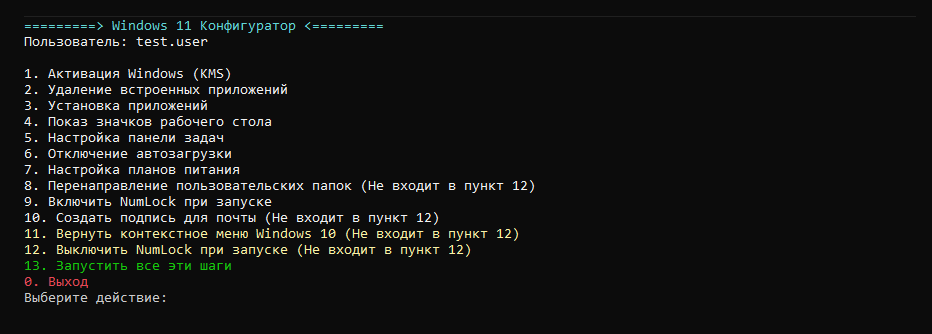
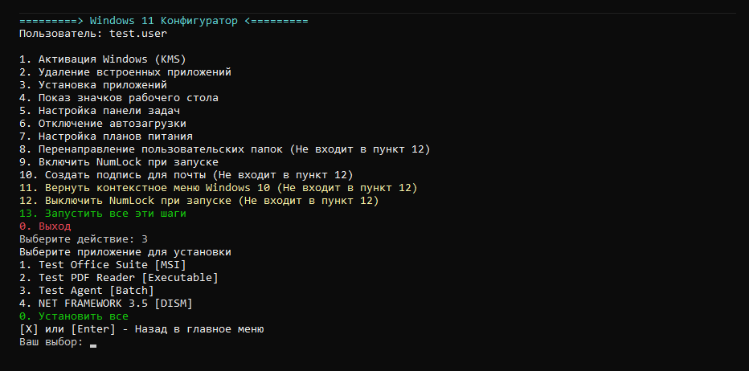

<p align="center">
  
</p>

# WindowsConfigurator

[](https://github.com/KirillGrachev/WindowsConfigurator/actions/workflows/tests.yml)
[](https://github.com/KirillGrachev/WindowsConfigurator/actions/workflows/codeql.yml)
[](LICENSE)
[](https://microsoft.com/powershell)

Одноразовая настройка Windows 10/11 из одного JSON-файла: активация, удаление
встроенного ПО, установка приложений, политики, автозагрузка, питание, NumLock,
перенаправление папок и подпись Outlook. Всё проверяется по JSON Schema до
первого изменения системы, а тестовый режим позволяет прогнать полный сценарий
без прав администратора и без единого реального изменения.

## Возможности

- **Один конфиг** — `config/config.json` с валидацией по `config/config.schema.json`.
- **Интерактивное меню** — пошаговый выбор действий с подменю установки приложений.
- **Пакетный режим** — `-RunAll` или выбранные шаги через `-RunSteps`.
- **Идемпотентность** — уже установленные приложения пропускаются, повторный запуск безопасен.
- **Секреты** — ссылки `env:`, `file:` и `dpapi:` вместо открытых ключей в JSON.
- **Тестовый режим** — реестр, процессы, файлы и Appx симулируются в песочнице.
- **Подпись Outlook** — HTML/RTF/TXT из данных AD, шаблона и логотипа.
- **Кроссплатформенные тесты** — Pester 5/6, Windows PowerShell 5.1 и PowerShell 7.

## Скриншоты

Главное меню (тестовый режим, без прав администратора):



Подменю установки приложений; `X`, `Q` или `Enter` возвращают в главное меню:



## Требования

- Windows 10 19045+ или Windows 11;
- права администратора для реального применения (в тестовом режиме не нужны);
- Windows PowerShell 5.1 или PowerShell 7+;
- `Run_Windows11Setup.cmd` запускает конфигуратор через `pwsh.exe` (PowerShell 7).

## Быстрый старт

```powershell
git clone https://github.com/KirillGrachev/WindowsConfigurator.git
cd WindowsConfigurator

# 1. Проверить конфигурацию по схеме
powershell -NoProfile -ExecutionPolicy Bypass -File .\Configure-Windows.ps1 -ValidateConfig

# 2. Прогнать всё в тестовом режиме (ничего не меняет)
powershell -NoProfile -ExecutionPolicy Bypass -File .\Configure-Windows.ps1 -TestMode -RunAll -UserName demo.user

# 3. Интерактивное меню
.\Run_Windows11Setup.cmd
```

Или напрямую:

```powershell
# все шаги из General.DefaultSteps
.\Configure-Windows.ps1 -RunAll -UserName 'john.doe'

# только выбранные шаги
.\Configure-Windows.ps1 -RunSteps 'Desktop','Taskbar','NumLock' -UserName 'john.doe'

# интерактивное меню
.\Configure-Windows.ps1 -Interactive
```

Коды возврата: `0` — успех, `1` — часть шагов завершилась ошибкой, `2` —
критическая ошибка запуска или невалидная конфигурация.

## Конфигурация

Поставляемый `config/config.json` — **тестовая** конфигурация с заглушками
(`Meta.IsTestData = true`). Перед боевым применением замените значения и
поставьте `IsTestData: false`; конфигуратор предупредит об оставшихся тестовых
данных.

| Раздел | Назначение |
| --- | --- |
| `Meta` | Версия, компания, сопровождение, признак тестовых данных |
| `General` | Шаги по умолчанию, задержки, поведение при ошибках |
| `Logging` | Уровень, путь и срок хранения журнала |
| `Environment` | Поддерживаемые сборки Windows, шаблоны имён ПК |
| `Secrets` | Провайдер секретов (`Plain`/`Environment`/`Dpapi`) |
| `Activation` | KMS-ключ, сервер, порт, защита от тестовых ключей |
| `Deployment` | Корень репозитория приложений, коды возврата, повторы |
| `AppsToRemove` | Appx-пакеты по категориям |
| `LegacyAppsToRemove` | Классические приложения и их деинсталляторы |
| `AppsToInstall` | MSI/EXE/Batch/DISM-приложения, пост-установка и копирование |
| `AutoStartApps` | Группы автозагрузки по именам ярлыков/процессов |
| `AutostartTweaks` | Твики служб, задач и политик для групп автозагрузки |
| `DesktopSettings`, `TaskbarSettings` | Значки рабочего стола и политики панели задач |
| `PowerSettings` | План питания и таймауты |
| `NumLock` | Состояние NumLock при входе |
| `FolderRedirection` | Перенос папок профиля на несистемный диск |
| `SignatureSettings` | Шаблон, логотип и фолбэки подписи Outlook |
| `ContextMenu` | Классическое контекстное меню Windows 10 |
| `Menu` | Заголовок и пункты интерактивного меню |
| `WindowsVersions` | Метки версий Windows по номеру сборки |

Подробнее — [docs/configuration.md](docs/configuration.md).

### Секреты

Не храните боевые ключи открытым текстом. Вместо значения можно указать ссылку:

```json
"KmsClientKey": { "$secret": "env:WC_KMS_KEY" }
```

Поддерживаются `env:`, `file:` и `dpapi:` (см. `tools/New-EncryptedSecret.ps1`).
Журнал маскирует значения секретов. Приватные конфигурации (`config/*.local.json`,
`config/prod.json`, `secrets/`, `*.bin`) исключены через `.gitignore`.

## Тестовый режим

```powershell
.\Configure-Windows.ps1 -TestMode -Interactive
.\Configure-Windows.ps1 -TestMode -RunSteps 'Installation','Desktop','NumLock' -UserName demo.user
```

В тестовом режиме:

- права администратора не проверяются;
- реестр пишется в оверлей, процессы и Appx симулируются;
- файлы попадают в `%TEMP%\WC-TestMode-*`;
- по завершении создаётся `testmode-report.json` с журналом операций.

Подробнее — [docs/test-mode.md](docs/test-mode.md).

## Структура

```text
Configure-Windows.ps1        точка входа и коды возврата
Run_Windows11Setup.cmd       launcher: администратор + pwsh + интерактивное меню
config/config.json           конфигурация (в поставке — тестовая)
config/config.schema.json    JSON Schema с дефолтами и правилами
functions/                   шаги, меню, общие функции
tools/                       проверка кодировок, секреты, запуск
tests/                       Pester-тесты и тестовые хелперы
docs/                        документация и скриншоты
```

## Проверки и безопасность

- **CI** — матрица Windows PowerShell 5.1 / PowerShell 7, Pester 5.7.1 / 6.2.0,
  Linux и Windows, покрытие не ниже 80%.
- **PSScriptAnalyzer** — 0 замечаний с профилем `ScriptAnalyzerSettings.psd1`.
- **CodeQL** — анализ GitHub Actions.
- **Статические проверки** — кодировки, CRLF/BOM, валидация схемы, отсутствие
  корпоративных данных в коде.
- **Релизы** — подписанные теги `v*`, ZIP-архив и `SHA256SUMS`.

## Разработка

```powershell
# тесты (Pester установится в локальный кэш)
.\tests\Run-Tests.ps1 -PesterVersion 5.7.1

# тесты + покрытие + анализатор
.\tests\Run-Tests.ps1 -PesterVersion 5.7.1 -WithCoverage -MinimumCoverage 80 -WithAnalyzer
```

Правила участия — [CONTRIBUTING.md](CONTRIBUTING.md), уязвимости —
[SECURITY.md](SECURITY.md).

## Лицензия

MIT — см. [LICENSE](LICENSE).
