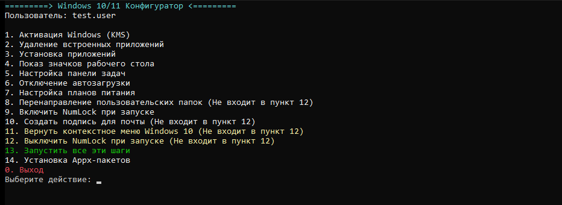
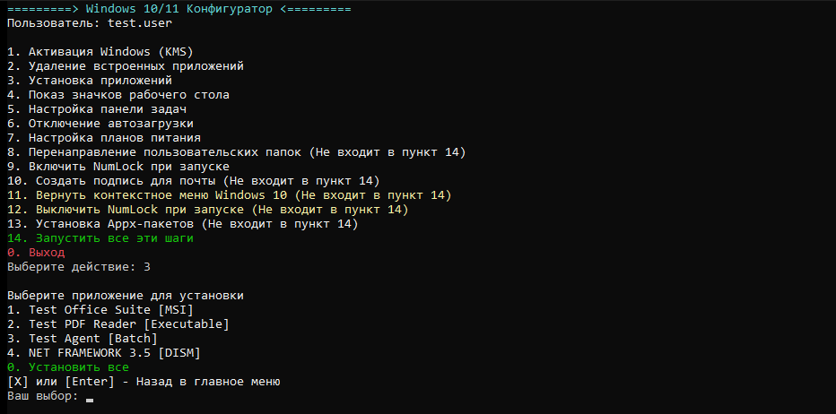

# WindowsConfigurator

Base Windows 10/11 setup from a single JSON file: activation, built-in app
removal, software installation, policies, autostart, power, NumLock, folder
redirection and Outlook signature.

The configuration is validated against JSON Schema before any system change, and
TestMode runs the full scenario without administrator rights and without real
changes.

[](https://github.com/KirillGrachev/WindowsConfigurator/actions/workflows/tests.yml)
[](https://github.com/KirillGrachev/WindowsConfigurator/actions/workflows/codeql.yml)
[](../LICENSE)

## Features

- **One config** — `config/config.json` or `config/config.yaml`, validated against `config/config.schema.json`.
- **Interactive menu** — pick steps one by one, with submenus for MSI/EXE and Appx/MSIX installation.
- **Batch mode** — run everything with `-RunAll` or selected steps with `-RunSteps`.
- **Idempotent** — already installed applications and Appx packages are skipped; repeated runs are safe.
- **Appx dependencies** — dependencies are installed before the main `.appx`/`.msix`/`.msixbundle`.
- **Secrets** — `env:`, `file:` and `dpapi:` references instead of plaintext keys in the configuration.
- **TestMode** — registry, processes, files and Appx operations are simulated in a sandbox.
- **Outlook signature** — HTML/RTF/TXT generated from AD data, a template and a logo.
- **System-drive aware** — the real system drive is detected instead of assuming `C:`.
- **Cross-platform tests** — Pester 5/6, Windows PowerShell 5.1 and PowerShell 7.

## Requirements

- Windows 10 19045+ or Windows 11;
- Administrator rights for real runs (TestMode does not require them);
- Windows PowerShell 5.1 (built into Windows) or PowerShell 7+;
- `Run_Windows11Setup.cmd` uses Windows PowerShell 5.1, so `pwsh.exe` is not required.

## Quick start

```powershell
git clone https://github.com/KirillGrachev/WindowsConfigurator.git
cd WindowsConfigurator

# Validate the configuration against the schema
powershell -NoProfile -ExecutionPolicy Bypass -File .\Configure-Windows.ps1 -ValidateConfig

# Run everything in TestMode (no changes are made)
powershell -NoProfile -ExecutionPolicy Bypass -File .\Configure-Windows.ps1 -TestMode -RunAll -UserName demo.user

# Interactive menu
.\Run_Windows11Setup.cmd
```

Or directly:

```powershell
# all steps from General.DefaultSteps
.\Configure-Windows.ps1 -RunAll -UserName 'john.doe'

# selected steps only
.\Configure-Windows.ps1 -RunSteps 'Desktop','Taskbar','NumLock' -UserName 'john.doe'

# interactive menu
.\Configure-Windows.ps1 -Interactive
```

Exit codes: `0` — success, `1` — some steps failed, `2` — fatal startup error
or invalid configuration.

## Screenshots

Main menu (TestMode, no administrator rights):



Application installation submenu; `X`, `Q` or `Enter` returns to the main menu:



## Configuration

The shipped `config/config.json` is a **test** configuration with placeholders
(`Meta.IsTestData = true`). Before a production run, replace the values and set
`IsTestData: false`; the configurator warns about remaining test data.

| Section | Purpose |
| --- | --- |
| `Meta` | Version, company, maintainer, test-data flag |
| `General` | Default steps, delays, failure handling |
| `Logging` | Log level, path and retention |
| `Environment` | Supported Windows builds, computer-name patterns |
| `Secrets` | Secret provider (`Plain`/`Environment`/`Dpapi`) |
| `Activation` | KMS key, server, port, test-key protection |
| `Deployment` | Application repository root, exit codes, retries |
| `AppsToRemove` | Appx packages grouped by category |
| `LegacyAppsToRemove` | Classic applications and their uninstallers |
| `AppsToInstall` | MSI/EXE/Batch/DISM applications, post-install and file copy |
| `AutoStartApps` | Autostart groups by shortcut or process name |
| `AutostartTweaks` | Service, scheduled-task and policy tweaks per group |
| `DesktopSettings`, `TaskbarSettings` | Desktop icons and taskbar policies |
| `PowerSettings` | Power plan and timeouts |
| `NumLock` | NumLock state at sign-in |
| `FolderRedirection` | Move profile folders to a non-system drive |
| `SignatureSettings` | Outlook signature template, logo and fallbacks |
| `ContextMenu` | Classic Windows 10 context menu |
| `Menu` | Interactive menu title and items |
| `WindowsVersions` | Windows version labels by build number |

See [configuration.md](configuration.md) for details.

### Secrets

Do not store production keys in plaintext. Reference a secret instead:

```json
"KmsClientKey": { "$secret": "env:WC_KMS_KEY" }
```

`env:`, `file:` and `dpapi:` references are supported (see
`tools/New-EncryptedSecret.ps1`). The log masks secret values. Private
configurations (`config/*.local.json`, `config/prod.json`, `secrets/`, `*.bin`)
are excluded by `.gitignore`.

## TestMode

```powershell
.\Configure-Windows.ps1 -TestMode -Interactive
.\Configure-Windows.ps1 -TestMode -RunSteps 'Installation','Desktop','NumLock' -UserName demo.user
```

In TestMode:

- Administrator rights are not checked;
- Registry writes go to an in-memory overlay; processes and Appx operations are simulated;
- Files are written to `%TEMP%\WC-TestMode-*`;
- The `testmode-report.json` report is created with the operation journal.

See [test-mode.md](test-mode.md) for details.

## Backup and rollback

When the configurator is started through `Configure-Windows.ps1` in a real run
(not TestMode and not `-WhatIf`), it creates a registry backup session under
`%TEMP%\WindowsConfigurator\Backup-<timestamp>` before the first change.

- Every registry key is exported once, before its first modification.
- Keys that did not exist are recorded and deleted on rollback.
- The journal is written to `backup.json` after each change.

Restore the registry from a backup session with:

```powershell
.\tools\Restore-Backup.ps1 -Root "$env:TEMP\WindowsConfigurator\Backup-20261110-230000"
```

Use `-NoBackup` to skip the backup session. The current rollback covers only the
registry; application installs/removals, file moves and Outlook signature files
are not rolled back yet.

## Module usage

The project can be imported as a module instead of dot-sourcing the loader:

```powershell
Import-Module .\WindowsConfigurator.psd1 -DisableNameChecking
$config = Import-Configuration -Path .\config\config.json
```

`-DisableNameChecking` is needed because the module keeps a few legacy
compatibility verbs. The module exports the normal functions only; use
`Configure-Windows.ps1 -TestMode` when the TestMode helpers are required.

## Project structure

```text
Configure-Windows.ps1        entry point and exit codes
WindowsConfigurator.psd1    module manifest
Run_Windows11Setup.cmd       launcher: elevation + Windows PowerShell 5.1 + interactive menu
config/config.json           configuration (test data in the repository)
config/config.schema.json    JSON Schema with defaults and rules
functions/                   steps, menu and shared functions
functions/TestMode/          TestMode implementation (opt-in)
tools/                       encoding checks, secrets, test runner
tests/                       Pester tests and test helpers
tests/integration/           elevated real-Windows checks
docs/                        all markdown, documentation and screenshots
```

## Checks and security

- **CI** — Windows PowerShell 5.1 / PowerShell 7, Pester 5.7.1 / 6.2.0,
  Linux and Windows, with an 85% coverage threshold and a Pester lock.
- **PSScriptAnalyzer** — 0 findings with the `ScriptAnalyzerSettings.psd1` profile.
- **CodeQL** — GitHub Actions analysis.
- **Static checks** — encodings, CRLF/BOM, schema validation and no corporate
  data in code.
- **Releases** — `v*` tags, ZIP archive and `SHA256SUMS`.

## Development

```powershell
# tests (Pester is installed into a local cache)
.\tests\Run-Tests.ps1 -PesterVersion 5.7.1

# tests + coverage + analyzer
.\tests\Run-Tests.ps1 -PesterVersion 5.7.1 -WithCoverage -MinimumCoverage 80 -WithAnalyzer
```

Contribution rules — [CONTRIBUTING.md](CONTRIBUTING.md); vulnerabilities —
[SECURITY.md](SECURITY.md).

## License

MIT — see [LICENSE](../LICENSE).
